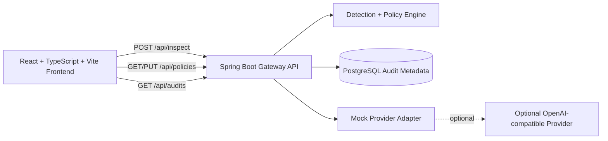

# PromptShield: AI Privacy Gateway

PromptShield is a full-stack MVP that inspects prompts before they reach an AI provider and applies explicit privacy rules with deterministic decisions:
- `ALLOW`: forward unchanged
- `MASK`: redact matched values and forward
- `BLOCK`: stop forwarding and explain why

The default demo works without any external AI account or key. It uses a deterministic mock provider response and labels demo behavior clearly.

## What PromptShield Shows
- Prompt inspection with category detection and matched policy rules
- Configurable demo policy actions (allow, mask, block)
- Before/after prompt masking preview
- Forwarding decision and mock provider response
- Privacy-safe audit trail with metadata-only storage
- Dockerized backend/frontend/database deployment path

## Architecture


## Stack
- Backend: Java 21, Spring Boot, Spring Validation, Spring Data JPA
- Frontend: React, TypeScript, Vite
- Database: PostgreSQL
- Packaging: Docker, Docker Compose
- CI: GitHub Actions (`.github/workflows/ci.yml`)

## Backend API
- `GET /api/health`
- `POST /api/inspect`
- `GET /api/policies`
- `PUT /api/policies/{ruleId}`
- `GET /api/audits`
- `GET /api/audits/summary`
- `DELETE /api/audits?olderThanDays=30`

## Detection Scope (Demo)
Pattern-based checks for:
- Email-like strings
- Phone-like numbers
- Payment-card-like numbers (with Luhn checksum validation)
- Common API-key formats (`sk-...`, `AIza...`, `ghp_...`)

PromptShield does not claim complete sensitive-data detection. Pattern matching can produce false positives/false negatives.

## Audit Storage Contract
Stored per inspection:
- Timestamp
- Final action and blocked flag
- Mode (demo/provider)
- Processing time
- Matched rule IDs and categories
- Finding count

Not stored:
- Raw prompt text
- Raw detected values
- Unmasked request bodies
- Provider API keys
- Full provider response payloads

## Threat Model Notes
This MVP addresses common accidental leak paths in app-to-provider prompt flows:
- Prevent obvious secrets/PII from forwarding via block/mask policies
- Avoid sensitive payload persistence in logs/audits
- Keep provider credentials server-side only

Known limitations:
- Pattern engine only covers scoped demos, not full DLP
- No authentication/authorization on policy editing in demo mode
- No legal compliance guarantees

## Local Run
### Prerequisites
- Java 21+
- Node.js 20+
- PostgreSQL 16+ (or Docker Compose)

### Docker Compose
```bash
docker compose up --build
```
- Frontend: `http://localhost:5173`
- Backend health: `http://localhost:8080/api/health`

### Manual Run
Backend:
```bash
cd backend
./gradlew bootRun
```

Frontend:
```bash
cd frontend
npm install
npm run dev
```

## Environment Variables
Use `.env.example` as the source of placeholders.

Important settings:
- `CORS_ALLOWED_ORIGINS`
- `AUDIT_RETENTION_DAYS`
- `INSPECT_MAX_PROMPT_LENGTH`
- `PROVIDER_ENABLED` (default `false`)
- `PROVIDER_API_KEY` (optional; never commit)

## Deployment (Render)
Use `render.yaml` Blueprint with:
- `promptshield-db` (PostgreSQL)
- `promptshield-backend` (Docker web service)
- `promptshield-frontend` (Docker web service)

Set environment values in Render dashboard (secure settings), not in source control.

## Testing
Backend tests cover:
- Detection and Luhn validation
- Allow/mask/block behavior via API
- Audit trail privacy-safe storage expectations
- Validation/error responses

Frontend tests cover:
- Rendering demo mode state
- Core inspect result display flow

## Demo Behavior Statement
When in demo mode, provider output is deterministic mock output and is explicitly labeled as mock. It is not produced by a live AI model.
